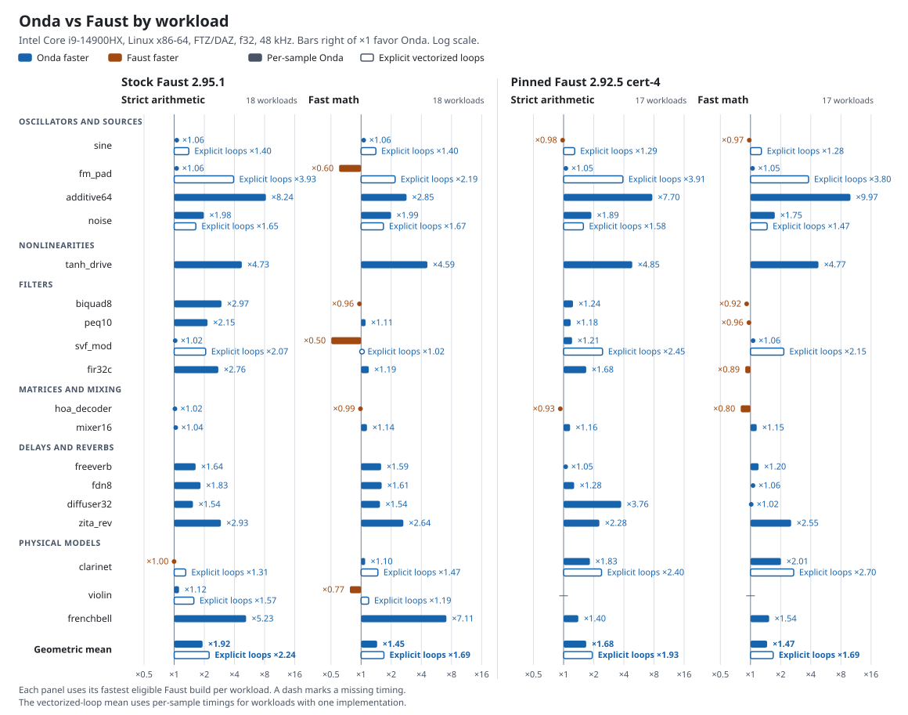

# Onda vs Faust benchmark

This suite compares native Onda and Faust DSP processing across 18 primary workloads at
48 kHz with 256-frame audio callbacks. The primary Onda implementations use
`sample` for audio-rate processing and `block` for shared setup. Six workloads also
have [explicit vectorized-loop implementations](dsp/explicit_loops/) for comparison. Each Onda source
is compiled with and without `--fast-math`. Faust candidates include scalar and vector
C++, the LLVM JIT, and the certification-4 compiler with the recorded autotuner options.
Fixed-rate Faust builds use the same compile-time sample rate as Onda.

The chart shows a Linux run on an Intel Core i9-14900HX with shared FTZ/DAZ. The strict
comparison uses `-ffp-contract=off` for Faust C++ and oCPP. The default Faust LLVM JIT
uses fast arithmetic and is included in the fast comparison. Each bar compares
median processing time per frame after a finite-output and per-channel error check.
See the [complete measurements](results/linux-x86_64/current.tsv).

<picture>
  <source media="(prefers-color-scheme: dark)" srcset="report/chart-dark.svg">
  
</picture>

| Onda schedule | Stock strict | Stock fast | Cert-4 strict | Cert-4 fast |
| --- | ---: | ---: | ---: | ---: |
| Per-sample | ×1.92 | ×1.45 | ×1.68 | ×1.47 |
| Explicit vectorized loops where available | ×2.24 | ×1.69 | ×1.93 | ×1.69 |

Stock is Faust 2.95.1 (`955f6e2ad`). The reference benchmark pins cert-4 to Faust
2.92.5 (`106dda74a`). Each column compares against the fastest eligible build from
that compiler. A ratio above ×1 means Onda is faster. The geometric means cover 18
workloads for stock and 17 for cert-4, which could not compile the violin. The
vectorized-loop means use per-sample timings for workloads with one Onda implementation.
[Compiler provenance](report/linux-audit.md#machine-and-provenance)

## Run the benchmark

The [Linux runner instructions](tools/linux/README.md#run-and-inspect) describe how to
build the compiler versions used here and set `faust_args`. The runner uses the primary
sources directly from [`dsp/`](dsp/) and measures them alongside any matching
[`dsp/explicit_loops/`](dsp/explicit_loops/) implementation in the same timing rounds.

```bash
python3 tools/linux/run.py "${faust_args[@]}" --cpu 12 --flush-denormals --out build/run
python3 report/readme_chart.py . --linux-results build/run/results.tsv \
  --machine 'Intel Core i9-14900HX, Linux x86-64, FTZ/DAZ'
```

Compilation, initialization, warmup, and output validation happen before timing. The Onda
harness calls the raw processor entry point and checks its execution status. Each run
interleaves the engine order and records median absolute deviation alongside the median.
The chart only ranks finite results with worst-channel relative RMS error at or below
0.001 against strict scalar Faust.

On macOS, `./run_all.sh` times the per-sample sources and writes its report to `build/macos/`.

## Sources and earlier measurements

The [optimization report](report/optimized-18.md) describes the measured source choices.
The [sine benchmark](dsp/sine.onda) uses Onda’s basic sine example verbatim, with the same
per-sample oscillator and default controls in [Faust](dsp/sine.dsp).
The [Zita benchmark](dsp/zita_rev.onda) uses the standalone patch’s shared cursor and
interleaved delay rings with the Faust benchmark’s wet signal path, damping and predelay.

The [Linux audit](report/linux-audit.md) documents the callback, numerical checks, and
toolchains. The [original Apple M5 report](report/onda-vs-faust.html) describes the
[original source revision](https://github.com/sletz/onda-vs-faust-bench/tree/95a4b9bdd20ad8a2dc8039ebfb558c765d91e934)
and its macOS benchmark procedure.
